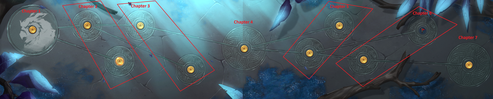

# Northgard

Northgard can be played in two modes, picked with the `game_mode` option in your YAML:
**Conquest**, the campaign map, or **Bifrost**, the roguelite.

## What does randomization do to this game?

### Conquest

Northgard's Conquest mode always unlocks its battles in the same fixed branching tree
(Chapter 01 leads to a Top/Bottom pair, each of those leads to another pair or a single
battle, and so on up to Chapter 07). Normally you unlock the next battle just by winning
the current one. In this randomizer, unlocking a Chapter instead requires receiving that
Chapter's item from the multiworld. It may be found in your own world or someone else's.

"Chapter" is this randomizer's own name for each position in that tree. It isn't
Northgard's own terminology, so here's what it actually maps to on your Conquest map:

Two Progression Modes control exactly how that gate works:
- **Linear**: same as vanilla Conquest's own flow. A Chapter also needs an adjacent Chapter
  beaten first, on top of owning its item.
- **Non-Linear**: a Chapter unlocks the moment you receive its item, letting you jump
  around the tree out of order. A separate option can require a number of other battles
  be won first before Chapter 07 specifically unlocks, so it can't be rushed immediately.

### Bifrost

Each realm is unlocked by an item. Midgard is always open; Muspelheim, Niflheim, Nidavellir,
Idavoll and Vanaheim each need the item named after them. In the lobby, a realm you don't have
yet shows as a greyed-out card you can't pick, and it lights up as soon as its item arrives.
Vanaheim is still only offered as the last step of a run.

Your progress carries over between runs, won or lost, so expect to play many runs.

## What is the goal?

- **Conquest:** win Chapter 07, the final battle of the Conquest tree.
- **Bifrost:** complete Vanaheim, the final realm.

## What items and locations get shuffled?

### Conquest

Each of the 11 Chapter positions has one unlock item. Each Chapter also has up to 10
locations ("Chapter N - Item 01" .. "Item 10"), sent together the moment you win that
Chapter's battle. The exact count per Chapter is set by the "Items per Chapter" option.

### Bifrost

Locations:
- Completing each realm (Vanaheim is the goal, not a location).
- Every objective a realm can have: its portals, the Wyvern, the Nidavellir Beacon, the
  Pillar of God and the Befriend objectives. Maps favour the objectives you haven't done yet.
- Some of the cards on perk screens (after a wave or an objective). These show the
  Archipelago logo, and hovering one shows which item it holds. Picking it sends that item
  instead of giving the perk; on later visits that card is a normal perk again. The "AP Perk
  Cards" option sets how many cards are Archipelago cards. Portal rewards always have one.

Items:
- The 5 realms.
- Bonus items: Military, Economy, Special, Clan and Objective Bonus, one bonus per realm (for
  example "Muspelheim Bonus"), and Building Unlock. At the start of every run each one becomes a
  random perk or building that fits your clan and that you don't have yet. They show in the
  game's Bonuses tab and last the whole run.

### Both modes

The rest of the pool is 7 resources (Krowns, Food, Wood, Lore/Faith, Stone, Iron, Military
Experience/Hunting Trophies), each as two kinds of item: a filler item (e.g. "100 Food")
grants that amount instantly while you're actively playing, but is lost if you're not
online to receive it; a "Starting" item (e.g. "50 Starting Food") is a one-time permanent
bonus applied at the start of every battle you play from then on, so it's never lost to
being offline.

## What does another world's item look like in Northgard?

There's no special in-game notification. The companion client applies a received item
quietly in the background (you'll see it in the client's own log), and the effect shows up
directly in-game: the Conquest map, the Bifrost realm cards or Bonuses tab, or your resource
totals the next time a battle is running.

## Multiplayer

Both modes can be played in co-op. Every player joins the same slot and runs their own
Northgard Client. In Bifrost, every player gets their own copy of each bonus item.
