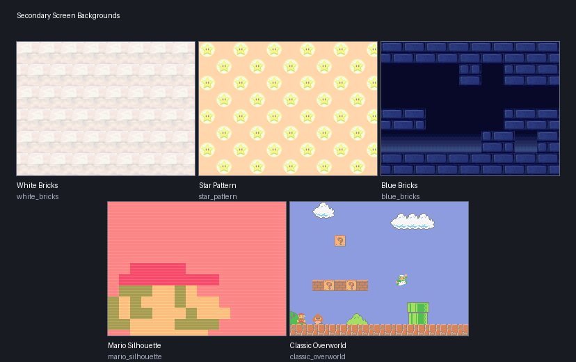

# New Super Mario Bros. DS

This randomizer adds Archipelago support to **New Super Mario Bros. DS**.
Clearing levels, collecting Star Coins, and finding secrets gives items to
players in the multiworld. Items received from other games unlock worlds,
routes, and Power-Ups. Single-player seeds are also supported.

For installation, patching the game, and connecting to a room, see the
[Setup Guide](setup_en.md).

[Checks & Logic Guide](checks_logic.md)
[Complete Check List](check_catalog.md)

> **Unstable release:** This version is still being tested. Gameplay, item
> delivery, and tracking may have bugs.

## Features

- Four goals; World Passes, Keys, Star Coin gates, and Power-Up Permits.
- Level, Star Coin, boss, Toad House, red-coin, secret-exit, and block checks.
- Level and music shuffling, character colors, and lower-screen backgrounds.
- Power-Ups, bonus items, 28 traps, and configurable Death Link.
- Client hints, item reserve, death counter, activity feed, and world-map saving.

[Goals](#goals) · [Checks](#checks) · [Progression](#progression) ·
[Items](#items) · [Client](#client) · [Death Link](#death-link) ·
[Traps](#traps) · [Customization](#customization)

## Goals

| Goal | Requirement |
|---|---|
| **Defeat Bowser** (default) | Defeat Bowser & Bowser Jr. in World 8-Bowser's Castle. |
| **Star Coin Hunt** | Receive the selected number of Star Coin items. |
| **World Tour** | Defeat all 9 Castle bosses. |
| **Completionist** | Defeat all 9 Castle bosses and receive the selected number of Star Coin items. |

For Star Coin Hunt and Completionist, **Required Star Coins** sets the target
from 30 to 240. The default is 80. All 240 Star Coin checks stay available,
even with a lower target.

**Received Star Coin items** pay for signs on the world map and count toward
the Star Coin goal. Spent Star Coins still count toward the goal. Overview tab
shows the available balance, the amount spent, and the total received.

## Checks

| Check category | Available checks | Included by default? |
|---|---|---|
| Level goals | 80 | Always |
| Star Coins | 240 | Always |
| Castle boss defeats | 9 | Always |
| Toad House rewards | 34 | Yes |
| Red Coin Challenges | 30 | Yes |
| Secret exits | 18 | No |
| Hidden or flying 1-Up Blocks | 43, plus 8 in the World 6-2 bonus room | No |
| Blocksanity | 1,038 Coin and Power-Up Blocks, plus 120 in the World 6-2 bonus room | No |

Secret exits include the Mini-Mario exits in the World 2 and World 5 castles.
Red Coin Challenges are completed by collecting all eight red coins before
the ring's timer runs out.

Toad House checks cover the 34 fixed houses on the world map. Temporary houses
spawned by finishing with matching timer digits do not add AP checks.

A Star Coin pickup completes a randomized check. Star Coin currency comes from
received Star Coin items.

### Star Coin Tracking

This setting controls when a Star Coin pickup completes its check:

- **Instant (default):** the pickup counts immediately and stays collected if
  Mario dies or leaves the level.
- **After Level Completion:** finishing the level is required to keep the pickup,
  as in the original game.

### Blocksanity and the World 6-2 bonus room

Blocksanity adds checks for supported Coin and Power-Up Blocks. This greatly
increases the number of checks. It is off by default.
Some special blocks, including hanging blocks, are not included yet.

**World 6-2 Bonus Area** enables the room's 128 flying blocks: 120 require
**Blocksanity**, and eight require **1-Up Block Checks**. All three options
are off by default. These bonus-room checks never contain required progression
items. At most 16 can contain items for other players, the rest contain local
filler or traps.

### Hidden and difficult checks

**Advanced Location Item Placement** controls items at difficult or hidden checks:

- **Allow Progression (default):** checks can contain items needed for progress.
- **Non-Progression:** checks cannot contain items needed for progress.

Both settings keep these checks in the game. Non-Progression reduces the need
to find hidden secrets or complete difficult jumps to get required items.

**1-Up Blocks** and **Blocksanity** have separate item placement settings:

| Setting | Allowed items |
|---|---|
| Excluded | Ordinary filler items and enabled traps. |
| Non-Progression (default) | Filler, useful bonuses, and enabled traps. No items needed for progress. |
| Progression | Any item, including items needed for progress. |

**Blocksanity Global Check Percentage** controls how many block checks can hold
items for other players. The remaining checks contain local filler or traps.
The normal host limit is 30%; the World 6-2 room keeps its separate limit of 16.

## Progression

### World Passes

World 1 is available at the start. The Desert, Isle, Jungle, Glacier, Mountain,
Cloud, and Volcano Passes open Worlds 2 through 8. Worlds can become available
in a different order from the original game.

Normal Castle-clear routes can also unlock later worlds without their Passes.
The alternate Mini-Mario and Warp Cannon routes count in logic when their
settings are enabled.

### Tower and Castle Keys

**Tower & Castle Keys** is enabled by default. Each Tower and Castle has its own
matching Key to unlock its route. Worlds with two Towers use separate Keys, and
World 8's Castle and Bowser's Castle also have separate Keys.

With this option off, these routes do not need Keys.
The route to Bowser's Castle also requires clearing the level at the
World 8-Tower 2 entrance.

### Star Coin signs

Signs need Star Coins. **Star Coin gates always use tiers**.
Higher tiers require more total received Star Coins. No Keys keeps those tiers
and the Star Coin price.

| Star Coin Gate Mode | Requirement |
|---|---|
| **No Keys** (default) | Enough received Star Coins for the sign's tier. |
| **Progressive** | Enough Star Coins and Progressive Gate Passes, which unlock tiers in order. |
| **Individual** | Enough Star Coins and the named Gate Pass matching that sign. |

Later tiers need more total received Star Coins. **Star Coin Gate Gap** sets
the step between tiers and the price of opening each sign, from 3 to 5
(default: 5). It applies to all 32 signs, including signs leading to side levels.
For example, with a gap of 5, tier 3 needs 15 total received Star Coins; opening
the sign spends 5 from the available balance. Spending does not reduce the
total received or goal progress.

No Keys and Individual modes shuffle the signs' tiers for each seed.
Progressive mode uses the fixed gate order.

### Power-Up Permits

A Permit allows use of one Power-Up type. It does not give that Power-Up.
The Power-Up must still be found in a level or received as an item.

Each license setting can be enabled separately: Mushroom, Fire Flower,
Blue Shell, Mini Mushroom, Mega Mushroom, and Touchscreen Pocket.
An enabled license requires its Permit. A disabled license allows normal use
without a Permit.

By default, Fire Flowers, Blue Shells, Mini Mushrooms, and Mega Mushrooms need
their Permits. Ordinary Mushrooms and the touchscreen pocket are usable without one.

Regular in-level Power-Up pickups disappear when their required Permit is missing.
Power-Ups received through Archipelago wait in the client until the Permit is
available. These items are not lost.

**Powerup Permit Placement** controls early access to selected Permits:

- **Normal (default):** no extra placement restrictions.
- **Early:** the Permits chosen in **Selected Powerup Permits** must be
  logically reachable by check sphere 2.

**Selected Powerup Permits** includes Mushroom Permit, Fire Flower Permit,
and Touchscreen Pocket Permit by default. Each selected Permit needs its license
setting enabled. Permits with disabled licenses are ignored. An empty selection
disables early placement. This setting affects Permits only. Permits in the
starting inventory do not need early placement.

Selected Permits can be placed in another player's game.

### Secret routes and cannons

Secret-exit shortcuts, the Mini-Mario routes to Worlds 4 and 7, and Warp Cannon
routes have separate settings. When enabled, the randomizer can expect these
routes to be used to reach checks.
All three logic settings are off by default. **Secret Exit Checks** separately
controls whether exits award AP items.
The physical exits and cannons remain available when their logic settings are off.

### Level Randomization

**Level Randomization** can keep the original layout, shuffle levels within
each world, or shuffle them across all worlds. Towers, Castles, secret-exit
levels, and ordinary levels stay in their matching groups. Bowser's Castle
always stays in place.

Check names follow the original level. For example, **World 3-3 Star Coin 3**
means the coin inside the original World 3-3 level, even if the level moved.
Keys and map routes follow the entrance on the world map.
The special Mini-Mario exits to Worlds 4 and 7 stay tied to their World 2 and
World 5 Castle entrances.

The client command `/level` finds level entrances:

| Command | Result |
|---|---|
| `/level W3-3` | Entrance for the original World 3-3 level. |
| `/level World 3-3 Star Coin 3` | Entrance for that check. |
| `/level world 3` | Levels on the World 3 map. |
| `/level all` | All level entrances. |

Hints also show the entrance for shuffled locations.

## Items

| Item | Effect |
|---|---|
| Mushroom, Fire Flower, Blue Shell, Mini Mushroom, Mega Mushroom | Adds the matching Power-Up to the waiting items. |
| Starman Buff | Gives 15 seconds of invincibility. |
| Starman Lite | Adds five seconds of invincibility, up to the normal buff duration. |
| 1-Up Mushroom | Adds one life. |
| 3-Up Moon | Adds three lives. |
| Small Coin Bundle / Coin Bundle / Large Coin Bundle | Adds 10 / 25 / 50 normal Coins. |
| Time Capsule | Adds 30 seconds to the level timer. |
| Small Care Package | Adds 15 seconds, five normal Coins, and one life. |
| Trap Shield | Blocks the next trap. Multiple charges can be stored. Shown as a cyan shield. |
| Life Insurance | Prevents the next death from costing a life. Shown as a green heart. |

### Item Reserve

Received Power-Ups are delivered through the touchscreen reserve pocket. If
the pocket is full, or a required Permit is missing, they wait in the client.
The **Power-ups** list in Overview shows what is waiting and any missing Permit.

**Settings → Item Reserve** has two modes:

- **Automatic:** an empty pocket refills automatically. Use **SET NEXT** to
  choose the next waiting Power-Up.
- **Manual:** use **SEND 1** to select one copy for delivery when the pocket
  is available. Further copies wait for another selection.

Waiting Power-Ups and the selection are saved for the current seed and player
slot across client restarts.

The same controls are available in the client chat:

- `/nsmbds_reserve automatic` or `/nsmbds_reserve manual` changes the mode.
- `/nsmbds_powerup Fire Flower` selects one waiting copy; `/nsmbds_powerup cancel`
  clears the selection.

## Client

The NSMBDS Client needs connections to Archipelago and BizHawk during play.
**Overview** shows goal progress, completed checks, received unlocks,
Star Coin balance, and waiting Power-Ups. **Hints** shows hinted items and locations.

A separate NSMBDS PopTracker pack supports map tracking. With the client and
tracker connected to the same slot, it can open the matching world or level map.

### Save Anytime

The patched game enables **SAVE** in the World Map menu. Saving is available
at any time on the world map. Use the same in-game save when continuing a seed.

### Death Counter

**Settings → Death Counter** shows the player's death total in Overview.
The counter keeps tracking when the display is hidden, including when Death
Link is disabled. Totals are saved separately for each seed and player slot.

`/deathcounter` shows the total and the number of Death Link deaths.
Other players' shared totals appear when available. Without shared totals,
the list shows Death Links received while the client was connected.
Missed Death Links are not added after reconnecting.

Normal deaths, insured deaths, and lethal timer drains count. Damage, time loss, or Coin loss alone do not count
as a death. Mario must actually die.

### Emulator activity feed

The in-game feed shows checks and item transfers. **Settings** controls its
width, position, fade-out time, and whether it is enabled.
Press **Ctrl+Shift+H** to temporarily hide or show it. Older messages may
reappear after reconnecting; this does not apply used bonuses or traps again.

## Death Link

Death Link is off by default. When enabled, deaths are shared with other
players who use Death Link. Their deaths can affect Mario too.

| Setting | Effect |
|---|---|
| **Amnesty** | Share every death, every fifth death, or another chosen interval. Default: every eligible death. |
| **Grace Percentage** | A 0–75% chance to ignore an incoming Death Link. |
| **Cooldown Seconds** | Ignore further incoming Death Links for a while after an effect is applied. |
| **Effect** | Defeat Mario, apply damage, remove 100 seconds, remove all normal Coins, or choose randomly. |
| **Random Effects** | Choose which effects are allowed when using Random. |
| **Trigger on Insured Deaths** | Share deaths prevented from costing a life by Life Insurance. Off by default. |

Damage removes a Power-Up and defeats Small Mario. Removing 100 seconds can
also defeat Mario when the timer reaches zero. Incoming effects wait until
a level is active and the game is not paused.

## Traps

**Trap Percentage** controls how often traps replace ordinary filler items.
It defaults to 15%; setting it to zero disables traps. **Traps** selects the
allowed effects. An empty selection disables traps.
**Filler Items** selects the helpful bonus categories. An empty selection fills
ordinary filler slots with Nothing; enabled traps can still appear.

Most timed traps last 15 seconds. Spotlight lasts ten seconds and I'm Stuck
lasts three. Bonk Trap can optionally be allowed to kill Small Mario.

**Movement and controls**

| Trap | Effect |
|---|---|
| Super Speed | Makes Mario move much faster. |
| Slowness | Makes Mario move more slowly. |
| Slippery Gloves | Temporarily disables wall jumps. |
| Ground Bound | Temporarily prevents jumping. |
| Hyper Confusion | Reverses left and right. |
| No Sprint | Temporarily disables sprinting. |
| Button Swap | Swaps the jump and sprint buttons. |
| Ice Shoes | Makes stopping and turning slippery. |
| Heavy Mario | Lowers jumps and makes Mario fall faster. |
| Can't Stop | Forces Mario to keep running. |
| Sticky Buttons | Briefly keeps released directions held. |
| No Turnaround Trap | Locks movement to the first chosen direction for 15 seconds. |
| Boo Curse | Repeatedly reverses horizontal controls. |
| I'm Stuck | Holds Mario in place for three seconds. |

**Camera and screen effects**

| Trap | Effect |
|---|---|
| Camera Drift | Pulls the camera to one side. |
| Screen Flip | Turns both DS screens upside down. |
| Drunk Camera | Makes the camera sway left and right. |
| Screen Tint | Covers the game with a colored tint. |
| Retro Filter | Adds an old-screen color and scanline effect. |
| Spotlight | Darkens everything outside a small visible area. |
| Pixelation | Makes the game view appear pixelated. |

**Damage, time, and item loss**

| Trap | Effect |
|---|---|
| Ground Clap | Ground pounds temporarily damage Mario. |
| Head Bonk | Hitting a block from below temporarily damages Mario. |
| Bonk Trap | Immediately damages Mario. |
| Coin Tax | Removes up to ten normal Coins. |
| Coin Thief | Removes all normal Coins. |
| Time Drain | Removes 50 seconds from the level timer. |
| Power-Up Pickpocket Trap | Steals the touchscreen reserve Power-Up. |

The usual host limit is a 50% trap rate. Higher trap rates and higher global
Blocksanity percentages depend on the host allowing them.

## Customization

### Character colors and lower-screen backgrounds

Mario and Luigi have separate color settings. Options include original colors, preset colors,
**Random Preset**, and **Crazy Random**.

Presets include Crimson, Emerald, Sapphire, Purple, Monochrome, Pastel Rosa,
Gold, Silver, and Peach. Random Preset chooses one preset for the seed.
Crazy Random randomizes the model's palette colors. Both random modes stay
consistent for the seed and player.

**Secondary Screen Background** can shuffle the five in-level lower-screen
wallpapers or use one design in every level: White Bricks, Star Pattern,
Blue Bricks, Mario Silhouette, or Classic Overworld.
**Vanilla (default)** keeps the original assignments. **Randomized** shuffles
all five designs once per seed and player, with every assignment changed.
Levels that shared a wallpaper still share its replacement.

### Music

Music can stay unchanged, shuffle in levels only, shuffle in levels and on
world maps separately, or mix both groups. Mixed music can place a world-map
track in a level or a level track on a world map.

Music choices stay consistent for the seed. Boss music, ambience, jingles,
menus, minigames, and Power-Up themes are unchanged. Level music retains the
BAH cues that enemies react to.

## Other

The generated YAML explains each setting. Groups such as `Star Coins`,
`Secret Exits`, `Red Coin Challenges`, `1-Up Blocks`, `Blocksanity`, and
`Toad Houses` allow settings to apply to a whole check category.
Excluding checks from progression does not remove them from the game.

For bug reports, `/nsmbds_diag full` shows the current connection and sync state.

For planned features, see the [Roadmap](https://github.com/Lemix028/Archipelago-NewSuperMarioBrosDS/blob/nsmbds/worlds/nsmbds/docs/Roadmap.md).

## Credits

- **xDesyyx** – Testing
- **Stigimon** – Testing
- **JunoWuno** – Ideas
